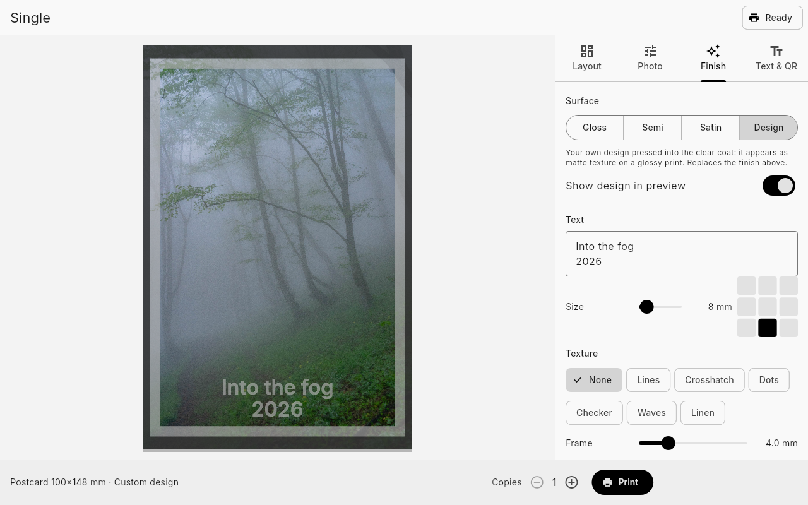
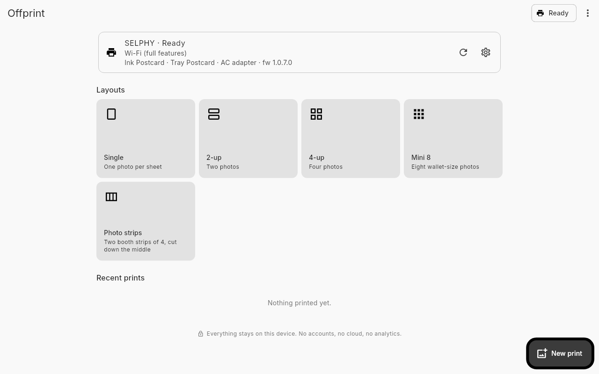
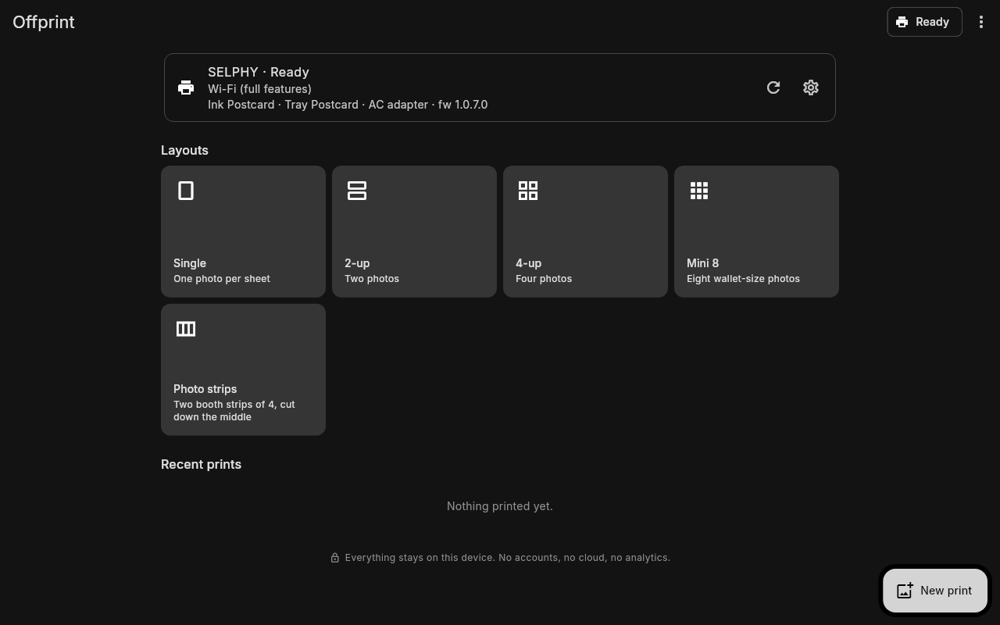
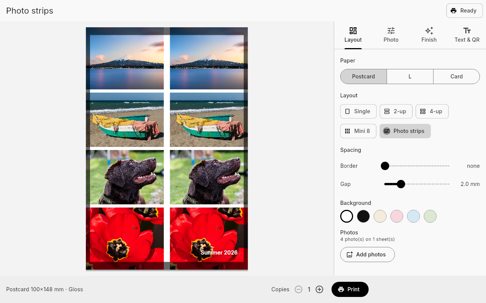
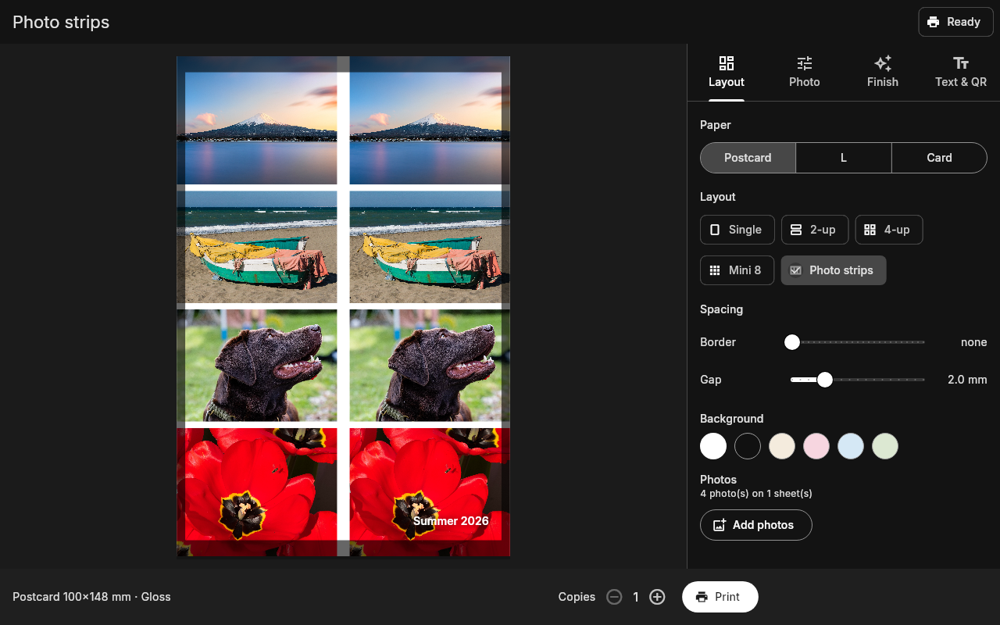
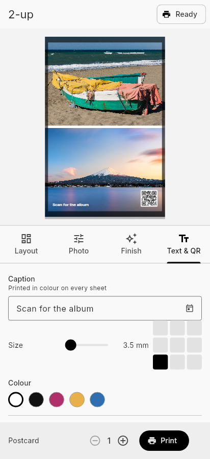
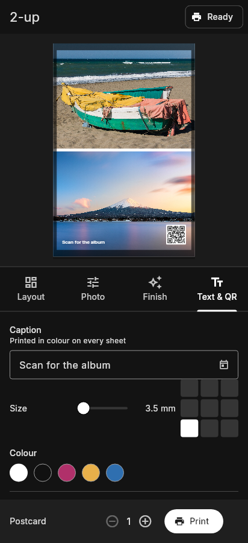

# Offprint

**Offline photo printing for Canon SELPHY printers** — for Linux, Windows and Android.

No account, no cloud, no analytics. Offprint talks directly to the printer over your own Wi-Fi or a USB
cable, and your photos, settings and print history never leave your device.

<p align="center">
  <picture>
    <source media="(prefers-color-scheme: dark)" srcset="docs/screenshots/editor-design-dark.png">
    
  </picture>
</p>

> Offprint is an independent project. It is not affiliated with, endorsed by or supported by Canon Inc.
> Canon and SELPHY are trademarks of Canon Inc.

## Features

- **Layouts:** single photo, 2-up, 4-up, mini 8 (wallet size) and photo-booth strips
- **Paper:** Postcard, L and Card; borderless or with a white border; gap and background colour
- **Per photo:** drag to reposition, zoom, rotate (auto-fits orientation), brightness, contrast, saturation,
  warmth, black & white
- **Finishes:** Gloss, Semi-gloss or Satin
- **Custom overcoat designs:** press your own text, logo, signature, textures or a frame into the clear
  protective coat, where they show up as a matte texture when you tilt the print. Canon's app only offers a
  handful of fixed patterns.
- **Captions and QR codes** printed on the photo (links, messages, Wi-Fi details)
- **Live progress** through the yellow, magenta, cyan and overcoat passes, with plain-language printer errors
- **Direct connection (Android):** scan the QR code on the printer's screen to print without a router
- **Local print history** with thumbnails

### Light and dark

Offprint follows your system theme.

| Light | Dark |
|---|---|
|  |  |
|  |  |

<p align="center">
  
  &nbsp;&nbsp;
  
</p>

<sub>Photos in the screenshots are public domain (CC0) from Wikimedia Commons; see
[credits](docs/screenshots/CREDITS.md).</sub>

## Supported printers

Developed and tested with the **SELPHY CP1500**. Other recent CP models may work over IPP; reports welcome.

## Connections

| Connection | Platforms | Finishes and designs |
|---|---|---|
| **Wi-Fi** (printer on your network, or its own network via QR code) | Linux, Windows, Android | ✅ |
| **USB cable** via [`ipp-usb`](https://github.com/OpenPrinting/ipp-usb) | Linux | Gloss only |
| **Network IPP** address | Linux, Windows, Android | Gloss only |

Finishes and overcoat designs use Canon's network protocol, which the printer only offers over Wi-Fi
(see [docs/PROTOCOL.md](docs/PROTOCOL.md#1-ipp)). Wi-Fi printing stays on your local network.

## Install

Download the latest build from [Releases](../../releases).

**Linux:** `Offprint-x.y.z-x86_64.AppImage`. Make it executable (`chmod +x`) and run it. Needs a distribution
from 2024 or newer (glibc 2.39+). For printing over USB, install `ipp-usb` (most distributions ship it).

**Windows:** unzip `Offprint-x.y.z-windows-x64.zip` and run `offprint.exe`.

**Android** (7.0+; direct printer connection needs 10+):

| File | For |
|---|---|
| `Offprint-x.y.z-android-arm64-v8a.apk` | almost every phone from the last ~8 years |
| `Offprint-x.y.z-android-armeabi-v7a.apk` | older 32-bit phones |
| `Offprint-x.y.z-android-x86_64.apk` | emulators, Chromebooks |
| `Offprint-x.y.z-android-universal.apk` | any device (larger download) |

To get updates automatically, add this repository's URL to [Obtainium](https://github.com/ImranR98/Obtainium).

### Verifying downloads

Each release includes `SHA256SUMS.txt`. Android builds are signed with the Offprint release key, whose
certificate SHA-256 fingerprint is:

```
E4:ED:D9:B9:8B:25:C3:25:05:91:AB:AD:09:A8:7D:B0:38:9D:54:87:03:D6:25:B8:20:C7:44:62:AE:7E:3F:B0
```

Check it with `apksigner verify --print-certs Offprint-*.apk` or an app such as
[AppVerifier](https://github.com/soupslurpr/AppVerifier).

## Build from source

Requires [Flutter](https://docs.flutter.dev/get-started/install) 3.47 or newer.

```bash
cd app
flutter test
flutter run                      # or: flutter build linux | windows | apk --release
../packaging/linux/build-appimage.sh   # after a Linux release build
```

Linux builds need `clang cmake ninja-build pkg-config libgtk-3-dev`.

## Also in this repository

- [`docs/PROTOCOL.md`](docs/PROTOCOL.md): how the CP1500 is driven over IPP and Canon's CPNP network protocol,
  including the overcoat-mask format. Useful if you want to support SELPHY printers in your own software.
- [`tools/selphy-cli`](tools/selphy-cli): a small Python reference implementation and command-line printer.

## How it works

Offprint renders each sheet at the printer's native 300 dpi (with bleed), encodes it as a JPEG and, for
designs, packs a 1-bit overcoat mask. It then sends both using the same protocol the printer's official app
uses, worked out for interoperability. No Canon code or assets are included.

## License

[GNU GPL v3.0 or later](LICENSE). The bundled [Inter](https://rsms.me/inter/) font is under the SIL Open Font License
(see `app/assets/fonts/Inter-LICENSE.txt`). Licences of all included libraries are shown in the app under
**About → View licenses**.
